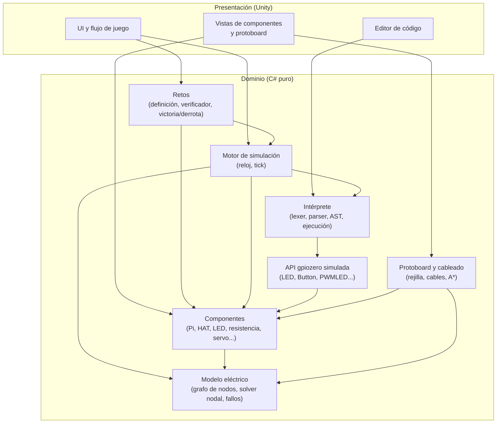
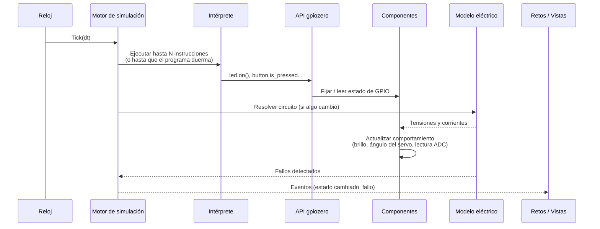

# Arquitectura: IMAT Pi Simulator

> Estado: **v0.2** (12/11/2026). La división en módulos, sus responsabilidades y sus dependencias (§1–§3) están **aprobadas**. Los patrones (§4) son candidatos hasta hacer los diagramas de clases de cada módulo.
>
> Base: decisiones de [requisitos.md](requisitos.md) §2.

## 1. Principio rector: dominio independiente de Unity

El simulador se divide en dos mundos:

**Dominio (C# puro, sin `UnityEngine`):**

- Componentes.
- Modelo eléctrico.
- Protoboard y A\*.
- Intérprete.
- Retos.
- Motor de simulación.

**Presentación (Unity):**

- `MonoBehaviour`, sprites, entrada del ratón, UI.

**Regla:** la presentación depende del dominio; el dominio **nunca** depende de la presentación. El dominio comunica cambios mediante eventos de C# (Observer) y la presentación se suscribe.

**Por qué:**

| Motivo | Detalle |
|--------|---------|
| Pruebas | El solver, el intérprete y el A\* se pueden probar con tests unitarios (Unity Test Framework, modo EditMode) sin abrir escenas. Encaja con el flujo "implementar → probar → commit" |
| Reinicio limpio (R4) | Reiniciar una partida es descartar el modelo y construir uno nuevo, sin GameObjects con estado residual |
| Más mejoras visuales después (§2.7) | Cambiar sprites o animaciones no toca la lógica |
| Calidad de código (R7) | Separación de responsabilidades visible en el UML |

## 2. Módulos



| Módulo | Responsabilidad | No hace |
|--------|-----------------|---------|
| **Modelo eléctrico** | Construir el grafo de nodos a partir de componentes y conexiones; resolver G·V = I; iterar los diodos; calcular corrientes; detectar fallos (sobrecorriente, cortocircuito, sobretensión) | No sabe qué es un LED ni un reto: solo trabaja con elementos que aportan su contribución a la matriz |
| **Componentes** | Modelo de cada componente: pines, parámetros, estado (LED quemado, ángulo del servo…), contribución eléctrica y comportamiento. La Pi expone GPIO configurables; la HAT agrupa sus componentes fijos | No dibuja nada; no conoce el intérprete |
| **Protoboard y cableado** | Rejilla de agujeros, tiras conectadas internamente, ocupación, cables; trazado óptimo de cables con A\* | No resuelve el circuito: solo dice qué está conectado con qué |
| **API gpiozero simulada** | Clases `LED`, `Button`, `PWMLED`, `LEDBoard`, `AngularServo`, `MCP3008` tal como las ve el programa del jugador; las traduce a operaciones sobre los GPIO simulados | No conoce el lexer ni el parser |
| **Intérprete** | Analizar el código del jugador (lexer → parser → AST), detectar errores y ejecutarlo de forma cooperativa (N instrucciones por tick, `sleep` sin bloquear, callbacks) | No accede directamente a los componentes: pasa por la API |
| **Motor de simulación** | Reloj de tiempo simulado y bucle de tick: ejecutar intérprete → aplicar estados de pines → resolver circuito → actualizar comportamientos → detectar fallos → notificar | No contiene lógica de componentes ni del lenguaje |
| **Retos** | Definición de cada reto (componentes disponibles, objetivo, límites); verificador que inyecta estímulos y comprueba salidas; decisión de victoria o derrota | No sabe cómo se dibuja nada |
| **Presentación** | Escenas, sprites, arrastrar y soltar, editor de código, menús, estados de pantalla | No toma decisiones de simulación |

## 3. Un tick de simulación



**Lectura de entradas:** cuando el programa lee `button.is_pressed`, el valor sale de la tensión del nodo del GPIO calculada en el **tick anterior**.

- Así se reproduce el comportamiento real de un bucle de scan: la lectura es una muestra en el tiempo, no un valor instantáneo perfecto.
- Además se evita resolver el circuito a mitad de una instrucción.

## 4. Problemas de diseño y patrones candidatos

Cada patrón se propone porque resuelve un problema concreto. Si al diseñar las clases el problema no aparece, el patrón se descarta.

| Problema | Patrón candidato | Módulo |
|----------|------------------|--------|
| El programa del jugador es un árbol de expresiones y sentencias anidadas | **Composite** (AST) + **Interpreter** | Intérprete |
| Hay que recorrer el AST para cosas distintas: comprobar errores, ejecutar, quizá resaltar sintaxis | **Visitor** | Intérprete |
| Las clases de la API (`LED`, `Button`…) deben funcionar sobre pines simulados sin saber cómo se implementan, igual que gpiozero con su `pin_factory` | **Bridge** (abstracción: API; implementación: `IPinFactory` / `IPin`) | API ↔ Componentes |
| Cada componente aporta a la matriz de forma distinta (conductancia, fuente, diodo) y el solver debe tratarlos igual | **Polimorfismo por interfaz** (`IElectricalElement.Stamp(...)`). No es un patrón GoF, pero es la base del diseño | Modelo eléctrico |
| La HAT es un componente formado por otros componentes (8 LEDs, 4 pulsadores, potenciómetro, MCP3008) | **Composite** | Componentes |
| Crear componentes a partir de la paleta o de la definición de un reto, sin que quien los pide conozca la clase concreta | **Factory** (Factory Method o Abstract Factory, por decidir) | Componentes |
| Muchas instancias del mismo tipo (agujeros de la protoboard, resistencias iguales) comparten datos pesados: sprite, disposición de pines, parámetros por defecto | **Flyweight** (datos intrínsecos en un `ScriptableObject` por tipo) | Componentes / Presentación |
| Elegir el algoritmo de trazado de cables (A\*, o uno más simple para depurar) | **Strategy** (`IRouter`) | Protoboard |
| El juego pasa por estados claros: menú → selección de reto → montaje → ejecución → victoria / derrota | **State** | Retos / UI |
| La UI y el intérprete necesitan un punto de entrada sencillo a un subsistema complejo | **Facade** (`SimulatorFacade`) | Motor de simulación |
| El modelo debe avisar a las vistas sin depender de ellas | **Observer** (eventos de C#) | Todos |

**Patrones de la lista de la asignatura que, de momento, no encajan:**

- **Singleton:** se evitará. Un estado global complica el reinicio limpio y las pruebas. Si hace falta un punto de arranque único, será un objeto raíz que construye y pasa las dependencias.
- **Decorator:** no hay ahora mismo un problema que lo pida. Un posible uso a estudiar: añadir instrumentación (medidores, registro de señales para el verificador) a un componente sin modificarlo.

## 5. Formato de los diagramas

**Decidido (12/11/2026): el UML oficial se hace en draw.io.**

- **Fuentes:** `docs/uml/*.drawio`, versionadas en el repo. Un archivo por diagrama.
- **Exportación:** PNG o PDF para el `.zip` de la entrega.
- **Mermaid:** los diagramas de este documento (§2, §3) se mantienen como vista rápida legible en GitHub. Si hay discrepancia, manda el draw.io.
- **Abrir los diagramas:** en app.diagrams.net, con *Archivo → Abrir desde → Este dispositivo*, o con la aplicación de escritorio de draw.io.

Alternativas descartadas:

| Opción | Motivo del descarte |
|--------|---------------------|
| Mermaid como formato oficial | Menos control sobre el acabado del diagrama entregado |
| PlantUML | Necesita Java (no instalado) o enviar los diagramas a un servidor externo |

## 6. Diseño: Modelo eléctrico y Componentes (v0.2, borrador)

Diagrama: [`uml/01_modelo_electrico_componentes.drawio`](uml/01_modelo_electrico_componentes.drawio), con tres páginas:

1. Modelo eléctrico.
2. Componentes: núcleo.
3. Componentes: Pi e IMAT HAT.

**Notación** (la misma que en la práctica 4 de la asignatura):

| Relación | Línea |
|----------|-------|
| Herencia | Continua, triángulo hueco en la clase padre |
| Realización de interfaz | Discontinua, triángulo hueco en la interfaz |
| Composición | Continua, rombo relleno en el todo |
| Agregación | Continua, rombo hueco en el todo |
| Asociación | Continua, flecha abierta; multiplicidad junto al extremo |
| Dependencia | Discontinua, flecha abierta; el estereotipo (`«crea»`, `«usa»`…) indica el tipo |

**Reglas de maquetación:**

- Las líneas no atraviesan clases ni se cruzan entre sí.
- Cada línea llega a un punto distinto de la clase.
- Las clases con **borde discontinuo** son referencias a clases detalladas en otra página. Se repiten junto a cada clase que las usa para que las líneas sean cortas.

### 6.1 Cómo se resuelve un circuito

| Paso | Qué hace | Clase |
|------|----------|-------|
| 1. Recoger elementos | Cada componente devuelve sus elementos eléctricos. La HAT, al ser compuesta, devuelve los de todos sus hijos | `Component.ElectricalElements()` |
| 2. Formar nodos | Todos los terminales unidos (por cables, tiras de la protoboard o enlaces internos de la HAT) se agrupan en un mismo nodo con una estructura union-find | `NetlistBuilder` (`DisjointSet`) |
| 3. Estampar | Cada elemento añade su contribución a la matriz G y al vector I. El solver no sabe qué componente es cada uno | `IElectricalElement.Stamp(IStampContext)` |
| 4. Resolver | Se resuelve G·V = I por eliminación gaussiana con pivoteo parcial. Los nodos de raíles (3,3 V, 5 V, GND) tienen tensión fija y se eliminan del sistema | `NodalSolver`, `MatrixStamper` |
| 5. Iterar diodos | Cada LED comprueba si su suposición (conduce / no conduce) es coherente con las tensiones obtenidas. Si alguno cambia, se vuelve a estampar y resolver, con un máximo de iteraciones | `INonlinearElement.UpdateRegion` |
| 6. Publicar resultados | Cada elemento calcula su corriente y su estado (brillo del LED, nivel leído por un GPIO…) | `IElectricalElement.OnSolved` |
| 7. Detectar fallos | Se consultan los elementos que pueden fallar | `FaultDetector` → `IFaultSource` → `Fault` |

**Modelos de cada elemento** (aplicación de §2.6 de requisitos):

| Elemento | Modelo |
|----------|--------|
| GPIO como salida | Equivalente de Norton: conductancia 1/R<sub>int</sub> en paralelo con una fuente de corriente V/R<sub>int</sub>. Así sigue siendo análisis nodal puro, sin fuentes de tensión ideales en la matriz |
| GPIO como entrada | Sin conductancia (alta impedancia), más la pull-up o pull-down interna como conductancia hacia 3,3 V o hacia GND |
| Pulsador | Conductancia muy alta si está pulsado; nada si no |

**Cortocircuitos:** se detectan al formar los nodos, sin necesidad de resolver. Si un mismo nodo queda unido a dos raíles con tensiones fijas distintas (por ejemplo, un cable de 3,3 V a GND), es un cortocircuito.

### 6.2 Patrones que aparecen en este diseño

| Patrón | Dónde | Problema que resuelve |
|--------|-------|-----------------------|
| **Composite** | `Component` ← `CompositeComponent` ← `ImatHat` | La HAT es un componente formado por otros (8 LEDs, 8 resistencias, 4 pulsadores, potenciómetro, MCP3008). El simulador la trata igual que a una resistencia suelta: le pide sus elementos y ella delega en sus hijos |
| **Flyweight** | `ComponentType` compartido por todas las instancias de un tipo | Los datos de cada tipo (pines, parámetros por defecto, sprite) se guardan una vez. Cada instancia solo guarda su estado (valor, posición, si está quemado) |
| **Factory** | `IComponentFactory` / `ComponentFactory` | La paleta y la definición de los retos crean componentes por su identificador de tipo sin conocer la clase concreta. Añadir un componente nuevo es registrar un creador, sin tocar el código que los pide |
| **Polimorfismo por interfaz** (no es GoF) | `IElectricalElement.Stamp` | El solver trata igual a todos los elementos; cada uno sabe cómo contribuye a la matriz |
| **Observer** | `Component.StateChanged` | Las vistas de Unity se enteran de los cambios (LED encendido, servo girado) sin que el dominio las conozca |

### 6.3 Aproximaciones de la simulación

Son modelos, no datos de la placa real:

| Aproximación | Detalle |
|--------------|---------|
| Condensadores antirrebote (C1–C4) | No se modelan. En continua un condensador es un circuito abierto, y los rebotes mecánicos no se simulan |
| Nodos flotantes | Una entrada sin pull-up y sin nada conectado tiene tensión indefinida en la realidad. Para que la matriz no sea singular, cada nodo lleva una conductancia mínima (`gmin`) a GND, que lo lleva a 0 V. **Pendiente:** decidir si el juego lo trata como lectura aleatoria, para que el jugador aprenda por qué hace falta la pull-up |
| Valores sin documentar | Resistencia interna del GPIO, umbral de lectura HIGH/LOW y velocidad del servo se marcan como *supuesto* en el diagrama hasta tener datos |
| Lectura de entradas | Una entrada se lee con la tensión calculada en el tick anterior (§3) |

### 6.4 PWM en el solver (decidido el 18/11/2026: propuesta A)

El análisis nodal es de continua, pero un pin PWM alterna entre 3,3 V y 0 V. Lo que importa depende del componente que esté conectado (es la distinción entre potencia media y pulsos de control):

| Componente | Qué le importa del PWM |
|------------|------------------------|
| LED con PWM | El brillo medio, que es aproximadamente el factor de servicio × el brillo en estado HIGH |
| Servo | El **ancho de pulso** (0,5–2,5 ms). El valor medio no le dice nada |

Por eso no sirve sustituir el PWM por su tensión media (1,65 V con un 50 %): por debajo de la tensión umbral del LED, el modelo diría que el LED no conduce nunca, cuando en realidad se enciende a plena corriente la mitad del tiempo.

**Propuesta:**

- **Fallos:** el pin PWM se resuelve en estado HIGH. Así se comprueban las corrientes de pico, que son las que queman.
- **Brillo:** el LED escala su brillo por el factor de servicio.
- **Servo:** recibe el `PwmSignal` del nodo al que está conectado (`ISolution.PwmAt`) y calcula el ángulo a partir del ancho de pulso.

**Decidido (18/11/2026): propuesta A**, implementada en E5. Se descartó la alternativa de resolver dos veces (HIGH y LOW) y ponderar por el factor de servicio: costaba el doble por tick, no era exacta con varios PWM y ningún reto la necesita.

### 6.5 Estado de la implementación (E1, 18/11/2026)

Implementado en `Assets/Scripts/Domain/Electrical` y `Components/Resistor.cs`, con tests en `Assets/Tests/EditMode/Electrical`.

**Diferencias con el diagrama v0.2** (a reflejar al actualizar el UML en E-UML):

| Cambio | Motivo |
|--------|--------|
| Nuevo `IVoltageReference`, implementado por `VoltageRail` (raíles 3V3, 5V, GND) | Los raíles no estampan nada: fijan la tensión de su nodo al construir la netlist |
| Nuevo `ShortCircuit` y `Netlist.ShortCircuits` | Un nodo con dos raíles de tensión distinta se detecta sin resolver. `NodalSolver` se niega a resolverlo. En E3 se convertirá en `Fault` |
| Desaparece `Netlist.Ground` | GND es un raíl más a 0 V. `gmin` conecta cada incógnita a 0 V |
| `IStampContext.DeclarePwm` todavía no existe | Llega en E5 |
| `NodalSolver.LastSystem` y `MatrixStamper.Describe()` | Para inspeccionar la matriz G·V = I al depurar y al explicar |
| `Resistor` implementa `IElectricalElement` directamente | En E4 heredará de `Component` |

**Valores numéricos:**

| Parámetro | Valor | Detalle |
|-----------|-------|---------|
| `gmin` | 1e-12 S (1 TΩ) | Error relativo de ~1e-9 en un divisor de 1 kΩ |
| Umbral de pivote | 1e-300 | Si se alcanza, la matriz es singular y se lanza una excepción con el nodo afectado |

**Etapa E2 (18/11/2026):** `GpioPin` y `PushButton` en `Components/`.

| Cambio | Detalle |
|--------|---------|
| `IStampContext.AddConductanceTo(nodo, g, V)` | Conductancia hacia una fuente ideal interna sin nodo propio: equivalente de Norton. La usan la salida del GPIO (fuente de 3,3 V o 0 V con su resistencia interna) y las pull-up y pull-down internas |
| `GpioPin` | Entrada de alta impedancia ideal, con pull opcional, o salida con resistencia interna. Lectura con tres estados (`Low`, `High`, `Undefined`) y "última lectura válida" en la zona indefinida |
| Modo inicial | Entrada sin pull, como tras `GPIO.cleanup()` |
| Pines `GpioPin` sueltos | Todavía no hay `RaspberryPi` que los agrupe; llega en E4 |

Los valores numéricos son supuestos y están en requisitos.md §2.6.

**Etapa E3 (18/11/2026):** `Led`, iteración del solver y fallos.

| Cambio | Detalle |
|--------|---------|
| `INonlinearElement.UpdateRegion` | El solver resuelve, pregunta a cada elemento no lineal si su región supuesta (conduce / no conduce) es coherente y, si alguno cambia, vuelve a resolver. Máximo de 50 iteraciones. Lo habitual son 2 |
| `Led` | Lineal a trozos: corte = abierto; conducción = Norton de V_F en serie con R_S. Si supera I_máx queda quemado (abierto) hasta `Reset()` |
| `IFaultSource.CheckFaults()` sin parámetro | Se aparta del diagrama v0.2: cada elemento ya guarda su estado al recibir la solución |
| Fallos persistentes | Un LED quemado o un GPIO dañado siguen así en las resoluciones siguientes, como en la placa real. Se reponen con `Reset()` al reintentar el reto |
| `FaultDetector` estático | Junta los cortocircuitos de la netlist (sin resolver) con los fallos de los elementos. Cada fallo trae un mensaje en castellano para el jugador |
| `FaultKind.PinConflict` | Todavía no existe; llega en E5 |

**Etapa E4 (18/11/2026):** capa de Componentes y la IMAT HAT completa.

| Pieza | Detalle |
|-------|---------|
| `Component` (abstracta) | Id, `Type`, `Pins`, `StateChanged` (Observer), `ElectricalElements()`, `InternalLinks()` y `Reset()` |
| `ElectricalComponent` (nueva, no estaba en el diagrama) | Hoja del Composite que es a la vez `IElectricalElement`. `Resistor`, `Led`, `PushButton`, `Potentiometer`, `Ldr`, `SolderJumper`, `ThreeWayJumper` y `Mcp3008` heredan de ella |
| `CompositeComponent` | Rol "Composite". Tiene hijos y pistas internas (`Link`), y delega `ElectricalElements()`, `InternalLinks()` y `Reset()` en sus hijos |
| `ComponentType` + catálogo `ComponentTypes` | Flyweight: una instancia por tipo, compartida |
| `ComponentFactory` | Registro de creadores por id de tipo. Combina los parámetros recibidos con los del tipo y rechaza parámetros desconocidos |
| `NetlistBuilderExtensions.AddComponent` / `Connect(Pin, Pin)` | Puente entre Componentes y el modelo eléctrico, sin que el modelo eléctrico conozca los componentes |
| `RaspberryPi` | Los 3 raíles y 28 `GpioPin`. Pines `GPIOn`, `3V3`, `5V` y `GND` |
| `ImatHat` | Cableada según el esquema (hardware.md §3): D1–D8 + R1–R8 + JP1/JP2, SW1–SW4, RV1 + JP3 → CH7 de U1. Los conectores J1, J2, J3, J7–J12 y TP1 son pines que apuntan al mismo terminal que la pista |
| Fuera del modelo por ahora | El L293 y J4–J6 (motores, ampliación), C1–C10 y BackPower |
| `Mcp3008` | De momento solo entradas de alta impedancia. La conversión llega en E5 |

**Etapa E5 (18/11/2026):** PWM, servo, ADC y conflictos de pines.

| Pieza | Detalle |
|-------|---------|
| `PwmSignal` | Frecuencia, factor de servicio, periodo y ancho de pulso |
| `IStampContext.DeclarePwm` / `ISolution.PwmAt` | El pin PWM se estampa en HIGH (corrientes de pico) y declara su señal. Tras resolver, la señal se propaga por los nodos unidos a través de elementos. No atraviesa raíles ni elementos `ISignalIsolating` (los canales del MCP3008). Si llegan dos PWM al mismo nodo, se queda la de mayor factor de servicio (aproximación) |
| `GpioPin` en modo `Pwm` | `ConfigureAsPwm(f, d)` y `SetDutyCycle(d)`. Con d = 0 se resuelve en LOW. `IsInUse` marca que el programa ha configurado el pin |
| `Led.DutyFactor` | Brillo = (I_pico / I_máx) × factor de servicio. Un LED sin resistencia se quema aunque el PWM sea bajo, porque cuenta la corriente de pico |
| `IBehavioralComponent.Update(dt)` | Se aparta del diagrama: no recibe la solución. El componente la guarda en `OnSolved` |
| `Servo` | Pines SIG, VCC y GND. De 0,5 a 2,5 ms → de 0 a 180° (lineal, con topes). `TargetAngle` cambia al instante y `Angle` lo sigue a velocidad limitada. Sin alimentación no se mueve; sin señal mantiene su posición |
| `Mcp3008` | Cuantización de 10 bits; `Read`, `ReadValue` (/1023) y `ReadVoltage` como en gpiozero. Solo se puede leer con el SPI activado. Sobretensión por canal |
| `RaspberryPi.SpiEnabled` y conflictos | Con SPI0 activo, usar GPIO7–11 como GPIO es `PinConflict`. `FaultDetector.Detect(netlist, pi)` acepta fuentes de fallo que no son elementos del circuito |

**Etapa E6 (18/11/2026):** analizador léxico, en `Assets/Scripts/Domain/Interpreter/`.

| Pieza | Detalle |
|-------|---------|
| `Token` / `TokenType` | Clase de token, texto original, valor (`long`, `double` o `string`) y posición (línea y columna desde 1) |
| `Lexer.Tokenize(texto)` | Devuelve la lista de tokens terminada en `EndOfFile`. Lanza `LexerException` con línea, columna y mensaje en castellano |
| Sangría | Pila de niveles: más sangría da `Indent`; menos, un `Dedent` por cada nivel cerrado, y tiene que coincidir con un nivel anterior. Tabulador = hasta el siguiente múltiplo de 8. Las líneas en blanco o solo con comentario no cuentan |
| Líneas lógicas | Dentro de `()`, `[]` y `{}` los saltos no terminan la sentencia; tampoco `\` al final de línea |
| Números | Decimales, `0x`, `0b`, `0o`, `_` entre dígitos (`20_000`), decimales con exponente. Se rechazan los ceros a la izquierda |
| Cadenas | Comillas simples o dobles, triples (varias líneas), escapes básicos y `r'...'`. Las f-strings y los bytes dan un error claro |
| Palabras clave fuera del subconjunto | `try`, `class`, `with`… se reconocen como palabras clave para que el parser dé un error explicativo en vez de "nombre desconocido" |

**Etapa E7 (18/11/2026):** analizador sintáctico y árbol del programa.

| Pieza | Detalle |
|-------|---------|
| `Ast.cs` | Nodos del árbol (**Composite**). `Expr`: número, cadena, constante, nombre, unaria, binaria, lógica, comparación encadenada, llamada (posicional y con nombre), atributo, índice, lista o tupla, lambda y expresión condicional. `Stmt`: expresión, asignación (múltiple), asignación compuesta, if (un `elif` es un `if` dentro del `else`), while, for, break, continue, pass, return, def, global, nonlocal e import |
| `IAstVisitor<T>` | **Visitor**: un método por clase de nodo. Cada operación sobre el árbol (imprimir, comprobar, ejecutar) es un visitor nuevo sin tocar los nodos |
| `AstPrinter` | Primer visitor. Expresiones en forma prefija (`(+ 2 (* 3 4))`) y sentencias una por línea |
| `Parser` | Descenso recursivo: un método por regla; la precedencia sale de qué método llama a cuál |
| `ScriptException` | Base común de `LexerException` y `ParseException` (y de los errores de ejecución en E8), con línea, columna y mensaje |

**Gramática** (de menor a mayor precedencia):

```
expression := lambda | or_test ['if' or_test 'else' expression]
or_test    := and_test ('or' and_test)*
and_test   := not_test ('and' not_test)*
not_test   := 'not' not_test | comparison
comparison := bit_or (comp_op bit_or)*          comp_op: < > <= >= == != in, not in, is, is not
bit_or     := bit_xor ('|' bit_xor)*
bit_xor    := bit_and ('^' bit_and)*
bit_and    := shift ('&' shift)*
shift      := arith (('<<' | '>>') arith)*
arith      := term (('+' | '-') term)*
term       := factor (('*' | '/' | '//' | '%') factor)*
factor     := ('+' | '-' | '~') factor | power
power      := primary ['**' factor]                   (asocia por la derecha)
primary    := atom ('(' args ')' | '.' NAME | '[' expression ']')*
atom       := NAME | NUMBER | STRING+ | True | False | None | '(' ... ')' | '[' ... ']'
```

**Fuera del subconjunto:** dan un error que dice "no está soportado":

- `class`
- `with`
- listas por comprensión y generadores
- diccionarios
- cortes (`lista[a:b]`)
- asignación a varias variables (`a, b = ...`)
- `*args`
- `from x import *`

**Decidido (18/11/2026): `try` / `except` / `finally` básico.** Aparece en casi todos los programas de las prácticas (`try: main() except KeyboardInterrupt: ... finally: GPIO.cleanup()`).

- Se analiza `try`, cero o más `except [Tipo] [as nombre]` (el que no lleva tipo, al final) y un `finally` opcional; al menos uno de los dos. Nodo `TryStmt`.
- En E8, el botón **Parar** del simulador lanzará `KeyboardInterrupt`, como Ctrl+C.
- No soportado: `raise`, `except (A, B)` y el `else` de un `try`.

**Etapa E8 (18/11/2026):** ejecución cooperativa, en `Interpreter/Runtime/`.

**Decidido (18/11/2026): opción A, recorrer el árbol con iteradores de C#.** Se descartó el bytecode (opción B): costaba bastante más trabajo (compilador, máquina virtual, tabla de manejadores para `try`) y ningún reto necesita su precisión. La opción A es el patrón **Interpreter** sobre el Composite del árbol.

| Pieza | Detalle |
|-------|---------|
| `Compiler : IAstVisitor<Executable>` | Visitor que, al cargar, convierte cada nodo en un delegado `Executable(Frame, Ref)` que es un iterador. Cada sentencia emite `Signal.Step` (consume presupuesto) y `sleep` emite `Signal.Sleep(s)`. Al reanudar, el iterador sigue exactamente donde estaba, aunque sea dentro de un bucle de una función llamada desde una expresión |
| `try` en iteradores | C# no permite `yield` dentro de un `try` con `catch`. El cuerpo protegido se recorre a mano (`Protected`): el `catch` envuelve solo a `MoveNext()`. El `finally` se ejecuta siempre, también tras `return` o `break` |
| `ScriptRuntime` | Planificador: `Load` (analiza y compila), `Start`, `Tick(dt)` (avanza el tiempo simulado y ejecuta hasta `StepsPerTick` = 1000 pasos), `Stop`, `EnqueueCall` (callbacks), `State`, `Error`, `CurrentLine`, `Output` y `LineWritten` |
| Tareas | El programa principal y cada callback son tareas; los callbacks se ejecutan intercalados y antes que el principal en cada tick. Una tarea dormida se aparca hasta su hora de despertar |
| Parar = Ctrl+C | `Stop()` despierta al principal y le entrega `KeyboardInterrupt` en la siguiente sentencia (o al volver de `sleep` o `pause`). Los callbacks se descartan. Un segundo `Stop()` mata el programa aunque ignore la interrupción |
| Ámbitos (`Scope`, `Frame`) | Reglas de Python: lo que se asigna dentro de una función es local salvo `global` o `nonlocal`; cierres para funciones anidadas y lambdas; `UnboundLocalError` como en Python |
| Valores | int → `long`, float → `double`, bool, str, None → `null`, `PyList`, `PyTuple`, `PyRange`, `PyFunction`, `NativeFunction`/`NativeCoroutine`, `PyModule` |
| `PyOps` | Semántica de los operadores: `/` siempre da decimal; `//` y `%` redondean hacia −∞; los bits solo con enteros; `str`/`repr` como Python (`0.30000000000000004`, `2.0`, `1e-05`) |
| Funciones integradas | `print` (con `sep` y `end`), `range`, `len`, `int`, `float`, `str`, `bool`, `abs`, `min`, `max`, `round` (redondeo bancario), `sum`, `list`, `tuple` y `reversed`. Métodos de lista: `append`, `insert`, `pop`, `remove`, `clear`, `index`, `count` y `reverse` |
| Módulos | `time` (`sleep`; `time` y `monotonic` devuelven el tiempo simulado) y `signal` (`pause`). `gpiozero` llega en E9. `RPi.GPIO` da un error que sugiere usar gpiozero |
| Errores | `PyException` lleva el tipo de Python, el mensaje en castellano y la posición más interna; si no se captura, se convierte en `ScriptRuntimeException`. Jerarquía para `except` (p. ej. `ZeroDivisionError` ⊂ `ArithmeticError` ⊂ `Exception`; `KeyboardInterrupt` no está dentro de `Exception`). Errores al cargar: `return` o `break` fuera de lugar, `nonlocal` en el módulo y tipo de excepción desconocido |
| Límites | `MaxCallDepth` = 100 (`RecursionError`); enteros de 64 bits (`OverflowError` si se desbordan) |

**Etapa E9 (24/11/2026):** API gpiozero simulada, en `Assets/Scripts/Domain/Api/`.

| Pieza | Detalle |
|-------|---------|
| **Bridge** | Abstracción: las clases de la API (`GzDigitalOutput`, `GzPwmOutput`, `GzLedBoard`, `GzDigitalInput`, `GzServo`, `GzMcp3008`). Implementación: `IPin` / `IPinFactory`. Implementación concreta: `SimulatedPinFactory`, que maneja los `GpioPin` del modelo eléctrico. Es lo mismo que la `pin_factory` real de gpiozero. Los tests usan una segunda implementación (`FakePinFactory`) para probar la API sin circuito |
| Clases | `LED`, `OutputDevice`/`DigitalOutputDevice`, `PWMLED`/`PWMOutputDevice` (100 Hz por defecto), `LEDBoard` (índices, `len`, `for`, `value` como tupla), `Button`, `InputDevice`, `Servo`, `AngularServo` (1–2 ms por defecto, como gpiozero) y `MCP3008`. Además `gpiozero.pins.pigpio.PiGPIOFactory`, que se acepta y no hace nada |
| Pines | Admite `20`, `"GPIO20"`, `"BCM20"` y `"BOARD38"` (pin físico → BCM con la tabla de hardware.md §1.3). Un pin solo puede tener un dueño (`GPIOPinInUse`); `close()` lo libera |
| Flancos y callbacks | `SimulatedPinFactory.Poll()`, tras cada resolución del circuito, compara el nivel de cada entrada con el anterior y avisa al dispositivo. `Button` encola `when_pressed`/`when_released` en el intérprete. Como en gpiozero, el callback recibe el dispositivo si tiene un parámetro obligatorio |
| `blink` | Tarea de fondo del intérprete (`ScriptRuntime.StartBackground`); `on()`, `off()` o `toggle()` la cancelan |
| `wait_for_press` | Espera cooperativa: comprueba en cada tick, con `timeout` opcional |
| Errores propios | Tipos `GPIOZeroError`, `GPIOPinInUse`, `PinInvalidPin`, `PinInvalidState`, `OutputDeviceBadValue`, `GPIODeviceClosed` y `SPIError` en la jerarquía (todos son `Exception`) |
| Orden de un paso | El programa ejecuta su tick → se resuelve el circuito → `Poll()` (flancos y callbacks) → comportamiento (servo). En E10 lo hará el motor de simulación |

**Cambios en capas anteriores:**

| Cambio | Motivo |
|--------|--------|
| `GpioPin.ConfigureAsInput` fija una lectura provisional según la pull | La tensión real no se conoce hasta la siguiente resolución. Sin esto, un `Button` recién creado leía "pulsado" con la tensión vieja, cuando el pin aún flotaba a 0 V. Aproximación: si un pulsador ya está pulsado al configurar, se ve en la resolución siguiente |
| `GpioPin.Release()` | `close()` libera el pin sin borrar sus daños |
| Una tarea que duerme no se reanuda en el mismo tick | Evita que `sleep(0)` o una espera activa acaparen el tick |
| `IPyIndexable` | `LEDBoard` admite índices, `len` y `for` |
| `PyFunction.RequiredParameterCount` | Para saber si un callback recibe el dispositivo |
| `PyException.RegisterType` | Para las excepciones propias de gpiozero |
| `PyOps.FormatFloat` sin `ToString("R")` | Busca a mano la representación más corta que, leída de vuelta, da el mismo número. El Mono de Unity y .NET daban resultados distintos (`0.89999999999999991` frente a `0.8999999999999999`); lo detectó el Test Runner de Unity |

**Etapa E10 (24/11/2026):** motor de simulación y fachada, en `Assets/Scripts/Domain/Simulation/`.

| Pieza | Detalle |
|-------|---------|
| `Circuit` | El montaje: Pi, IMAT HAT opcional, componentes externos y cables entre pines. `Version` cambia con la estructura; `BuildNetlist()` crea la netlist |
| `SimulationEngine` | El tick de §3: programa → circuito (solo si algo cambió) → flancos → comportamiento → fallos → eventos. Estados: `Idle`, `Running`, `Finished`, `Stopped`, `ProgramError` y `Faulted` |
| "Solo si algo cambió" | Firma = suma de `GpioPin.Version` (cada escritura o configuración del programa la incrementa) más `Invalidate()` (pulsar un botón, girar RV1, un fallo nuevo) más cambios de estructura. Sin cambios, no se resuelve |
| Fallos | Un fallo nuevo (deduplicado por tipo y origen) emite `FaultDetected`, aborta el programa (`ScriptRuntime.Abort`) y pasa a `Faulted`. El juego decidirá en E11 si es derrota |
| Fin del programa | Se liberan sus pines, como hace gpiozero al salir de Python: los LED se apagan |
| `SimulatorFacade` | **Facade** para la UI. Programa: `LoadProgram` → `LoadResult`, `Run`, `Stop`, `Reset`, `Tick`. Interacción: `PressButton`/`ReleaseButton`, `SetPotentiometer`, `SetSpiEnabled`. Lectura: `LedBrightness`, `IsLedBurnt`, `State`, `Output`, `Faults`, `CurrentLine` y `ProgramError`. Eventos (Observer): `StateChanged`, `FaultDetected`, `OutputLine` y `Ticked` |

**Cambios en capas anteriores:**

| Cambio | Detalle |
|--------|---------|
| `GpioPin.Version` | Contador de cambios |
| `ScriptRuntime.Abort()` | Detiene el programa sin `KeyboardInterrupt` |
| `RaspberryPi.Reset()` ya no desactiva el SPI | Es configuración de la Pi (`raspi-config`), no del programa |

**Etapa E14 (24/11/2026):** primera escena de Unity (`Assets/Scenes/Main.unity`).

| Pieza | Detalle |
|-------|---------|
| `ImatPiSim.Presentation` (asmdef) | Capa de presentación. Depende del dominio; el dominio no depende de ella |
| `SimulationRunner` | Único `MonoBehaviour` dueño de la `SimulatorFacade`. En cada `Update()` hace `Tick(min(deltaTime, 0,1 s))`. El programa se edita en el Inspector (campo `program`; por defecto, "LED mientras pulso" del Tema 3) y arranca al darle a Play. Panel provisional con `OnGUI`: estado, tiempo, línea, botones Ejecutar / Parar / Reiniciar, errores, fallos y salida de `print` |
| `BoardView` | Construye la HAT en código a partir del modelo: D1–D8 y SW1–SW4 con su GPIO (hardware.md §3.2 y §3.3) |
| `LedView` | Observa al `Led` del dominio (`StateChanged`) y traduce el brillo a color. Normaliza al brillo de un LED de la HAT en continua (≈ 0,2), así que PWM al 25 % → un cuarto. Si está quemado: gris con "X" |
| `ButtonView` | `OnMouseDown`/`OnMouseUp` sobre un `BoxCollider2D` (Input Manager clásico) → `PressButton`/`ReleaseButton` de la fachada; se redibuja al avisar el `PushButton` |
| `SpriteFactory` | Sprites provisionales (cuadrado y círculo) generados en código, una vez, y compartidos entre todas las vistas. Textos con `TextMesh` y la fuente integrada |
| `ImatPiSim.Editor` / `SceneBuilder` | Crea la escena desde el menú **IMAT Pi → Crear escena principal** o en batch (`-executeMethod ImatPiSim.EditorTools.SceneBuilder.BuildMainScene`), sin editar YAML a mano. Añade la escena a Build Settings |
| `ImatPiSim.PlayMode.Tests` | 3 pruebas en modo Play: la escena dibuja 8 LED y 4 pulsadores y arranca; SW1 enciende y apaga D1; SW4 termina el programa |

Las vistas no contienen lógica de simulación: leen el modelo y pasan las acciones a la fachada.

## 7. Decisiones abiertas para la siguiente iteración

| Decisión | Opciones | Afecta a |
|----------|----------|----------|
| Datos de los retos | `ScriptableObject` editables en Unity, o archivos JSON | Retos, Factory |

## 8. Estructura del repositorio y pruebas

Implantado en la etapa E0.2, el 18/11/2026, con **Unity 6000.0.85f2**.

```
Assets/
  Scripts/Domain/          ← dominio en C# puro (ImatPiSim.Domain.asmdef, noEngineReferences = true)
  Tests/EditMode/          ← tests NUnit del dominio (ImatPiSim.Domain.Tests.asmdef, solo Editor)
Packages/                  ← manifest de paquetes de Unity
ProjectSettings/           ← configuración del proyecto (modo 2D por defecto)
tools/DomainTests/         ← proyectos dotnet para ejecutar los mismos tests sin abrir Unity
  Domain/ImatPiSim.Domain.csproj       compila Assets/Scripts/Domain con .NET Standard 2.1 y C# 9
  ImatPiSim.Domain.Tests.csproj        compila Assets/Tests/EditMode con NUnit 3 (net10.0)
docs/                      ← documentación y UML
```

**Ensamblado del dominio (`noEngineReferences = true`):** Unity no le deja usar `UnityEngine`. Si alguien escribe `using UnityEngine;` en el dominio, deja de compilar. La regla del §1 la comprueba el compilador.

**Restricciones del lenguaje:** el proyecto dotnet del dominio usa .NET Standard 2.1 y C# 9, lo mismo que admite Unity 6. Si se usa una característica más moderna (por ejemplo, `namespace X;` en una línea, que es de C# 10), falla al compilar aquí.

**Paquetes añadidos:**

| Paquete | Versión | Para qué |
|---------|---------|----------|
| `com.unity.2d.sprite` | 1.0.0 | Sprites 2D |
| `com.unity.test-framework` | 1.6.0 | Test Runner y NUnit |
| `com.unity.ugui` | 2.0.0 | UI, con TextMeshPro incluido en Unity 6 |

Paquetes candidatos para más adelante, si hacen falta: URP 2D, para la iluminación de la etapa de pulido.

**Cómo ejecutar los tests:**

| Dónde | Cómo |
|-------|------|
| Fuera de Unity | `dotnet test tools/DomainTests` |
| En el editor | *Window → General → Test Runner → EditMode → Run All* |
| Unity sin interfaz | `Unity.exe -batchmode -nographics -projectPath . -runTests -testPlatform EditMode -testResults <ruta>.xml` |
