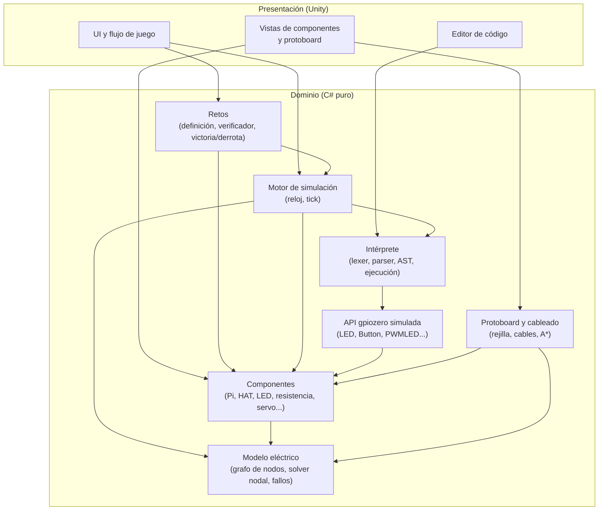
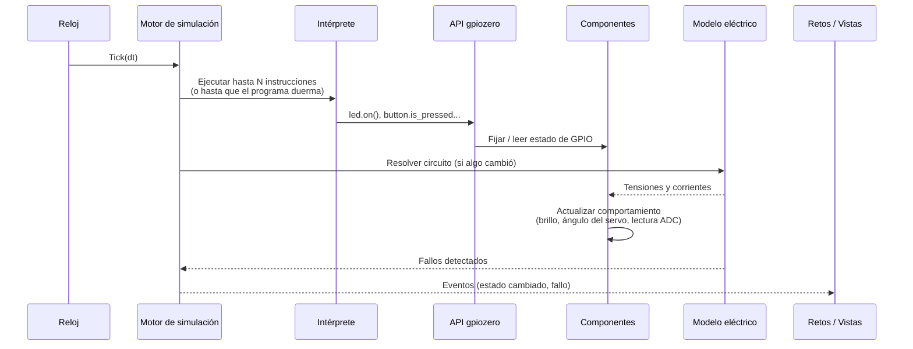

# Arquitectura: IMAT Pi Simulator

> Estado: **v0.2** (12/11/2026). La división en módulos, sus responsabilidades y sus dependencias (§1–§3) están **aprobadas**. Los patrones (§4) son candidatos hasta hacer los diagramas de clases de cada módulo.
>
> Base: decisiones de [requisitos.md](requisitos.md) §2.

## 1. Principio rector: dominio independiente de Unity

El simulador se divide en dos mundos:

**Dominio (C# puro, sin `UnityEngine`):**

- Componentes.
- Modelo eléctrico.
- Protoboard y A\*.
- Intérprete.
- Retos.
- Motor de simulación.

**Presentación (Unity):**

- `MonoBehaviour`, sprites, entrada del ratón, UI.

**Regla:** la presentación depende del dominio; el dominio **nunca** depende de la presentación. El dominio comunica cambios mediante eventos de C# (Observer) y la presentación se suscribe.

**Por qué:**

| Motivo | Detalle |
|--------|---------|
| Pruebas | El solver, el intérprete y el A\* se pueden probar con tests unitarios (Unity Test Framework, modo EditMode) sin abrir escenas. Encaja con el flujo "implementar → probar → commit" |
| Reinicio limpio (R4) | Reiniciar una partida es descartar el modelo y construir uno nuevo, sin GameObjects con estado residual |
| Más mejoras visuales después (§2.7) | Cambiar sprites o animaciones no toca la lógica |
| Calidad de código (R7) | Separación de responsabilidades visible en el UML |

## 2. Módulos



| Módulo | Responsabilidad | No hace |
|--------|-----------------|---------|
| **Modelo eléctrico** | Construir el grafo de nodos a partir de componentes y conexiones; resolver G·V = I; iterar los diodos; calcular corrientes; detectar fallos (sobrecorriente, cortocircuito, sobretensión) | No sabe qué es un LED ni un reto: solo trabaja con elementos que aportan su contribución a la matriz |
| **Componentes** | Modelo de cada componente: pines, parámetros, estado (LED quemado, ángulo del servo…), contribución eléctrica y comportamiento. La Pi expone GPIO configurables; la HAT agrupa sus componentes fijos | No dibuja nada; no conoce el intérprete |
| **Protoboard y cableado** | Rejilla de agujeros, tiras conectadas internamente, ocupación, cables; trazado óptimo de cables con A\* | No resuelve el circuito: solo dice qué está conectado con qué |
| **API gpiozero simulada** | Clases `LED`, `Button`, `PWMLED`, `LEDBoard`, `AngularServo`, `MCP3008` tal como las ve el programa del jugador; las traduce a operaciones sobre los GPIO simulados | No conoce el lexer ni el parser |
| **Intérprete** | Analizar el código del jugador (lexer → parser → AST), detectar errores y ejecutarlo de forma cooperativa (N instrucciones por tick, `sleep` sin bloquear, callbacks) | No accede directamente a los componentes: pasa por la API |
| **Motor de simulación** | Reloj de tiempo simulado y bucle de tick: ejecutar intérprete → aplicar estados de pines → resolver circuito → actualizar comportamientos → detectar fallos → notificar | No contiene lógica de componentes ni del lenguaje |
| **Retos** | Definición de cada reto (componentes disponibles, objetivo, límites); verificador que inyecta estímulos y comprueba salidas; decisión de victoria o derrota | No sabe cómo se dibuja nada |
| **Presentación** | Escenas, sprites, arrastrar y soltar, editor de código, menús, estados de pantalla | No toma decisiones de simulación |

## 3. Un tick de simulación



**Lectura de entradas:** cuando el programa lee `button.is_pressed`, el valor sale de la tensión del nodo del GPIO calculada en el **tick anterior**.

- Así se reproduce el comportamiento real de un bucle de scan: la lectura es una muestra en el tiempo, no un valor instantáneo perfecto.
- Además se evita resolver el circuito a mitad de una instrucción.

## 4. Problemas de diseño y patrones candidatos

Cada patrón se propone porque resuelve un problema concreto. Si al diseñar las clases el problema no aparece, el patrón se descarta.

| Problema | Patrón candidato | Módulo |
|----------|------------------|--------|
| El programa del jugador es un árbol de expresiones y sentencias anidadas | **Composite** (AST) + **Interpreter** | Intérprete |
| Hay que recorrer el AST para cosas distintas: comprobar errores, ejecutar, quizá resaltar sintaxis | **Visitor** | Intérprete |
| Las clases de la API (`LED`, `Button`…) deben funcionar sobre pines simulados sin saber cómo se implementan, igual que gpiozero con su `pin_factory` | **Bridge** (abstracción: API; implementación: `IPinFactory` / `IPin`) | API ↔ Componentes |
| Cada componente aporta a la matriz de forma distinta (conductancia, fuente, diodo) y el solver debe tratarlos igual | **Polimorfismo por interfaz** (`IElectricalElement.Stamp(...)`). No es un patrón GoF, pero es la base del diseño | Modelo eléctrico |
| La HAT es un componente formado por otros componentes (8 LEDs, 4 pulsadores, potenciómetro, MCP3008) | **Composite** | Componentes |
| Crear componentes a partir de la paleta o de la definición de un reto, sin que quien los pide conozca la clase concreta | **Factory** (Factory Method o Abstract Factory, por decidir) | Componentes |
| Muchas instancias del mismo tipo (agujeros de la protoboard, resistencias iguales) comparten datos pesados: sprite, disposición de pines, parámetros por defecto | **Flyweight** (datos intrínsecos en un `ScriptableObject` por tipo) | Componentes / Presentación |
| Elegir el algoritmo de trazado de cables (A\*, o uno más simple para depurar) | **Strategy** (`IRouter`) | Protoboard |
| El juego pasa por estados claros: menú → selección de reto → montaje → ejecución → victoria / derrota | **State** | Retos / UI |
| La UI y el intérprete necesitan un punto de entrada sencillo a un subsistema complejo | **Facade** (`SimulatorFacade`) | Motor de simulación |
| El modelo debe avisar a las vistas sin depender de ellas | **Observer** (eventos de C#) | Todos |

**Patrones de la lista de la asignatura que, de momento, no encajan:**

- **Singleton:** se evitará. Un estado global complica el reinicio limpio y las pruebas. Si hace falta un punto de arranque único, será un objeto raíz que construye y pasa las dependencias.
- **Decorator:** no hay ahora mismo un problema que lo pida. Un posible uso a estudiar: añadir instrumentación (medidores, registro de señales para el verificador) a un componente sin modificarlo.

## 5. Formato de los diagramas

**Decidido (12/11/2026): el UML oficial se hace en draw.io.**

- **Fuentes:** `docs/uml/*.drawio`, versionadas en el repo. Un archivo por diagrama.
- **Exportación:** PNG o PDF para el `.zip` de la entrega.
- **Mermaid:** los diagramas de este documento (§2, §3) se mantienen como vista rápida legible en GitHub. Si hay discrepancia, manda el draw.io.
- **Abrir los diagramas:** en app.diagrams.net, con *Archivo → Abrir desde → Este dispositivo*, o con la aplicación de escritorio de draw.io.

Alternativas descartadas:

| Opción | Motivo del descarte |
|--------|---------------------|
| Mermaid como formato oficial | Menos control sobre el acabado del diagrama entregado |
| PlantUML | Necesita Java (no instalado) o enviar los diagramas a un servidor externo |

## 6. Diseño: Modelo eléctrico y Componentes (v0.2, borrador)

Diagrama: [`uml/01_modelo_electrico_componentes.drawio`](uml/01_modelo_electrico_componentes.drawio), con tres páginas:

1. Modelo eléctrico.
2. Componentes: núcleo.
3. Componentes: Pi e IMAT HAT.

**Notación** (la misma que en la práctica 4 de la asignatura):

| Relación | Línea |
|----------|-------|
| Herencia | Continua, triángulo hueco en la clase padre |
| Realización de interfaz | Discontinua, triángulo hueco en la interfaz |
| Composición | Continua, rombo relleno en el todo |
| Agregación | Continua, rombo hueco en el todo |
| Asociación | Continua, flecha abierta; multiplicidad junto al extremo |
| Dependencia | Discontinua, flecha abierta; el estereotipo (`«crea»`, `«usa»`…) indica el tipo |

**Reglas de maquetación:**

- Las líneas no atraviesan clases ni se cruzan entre sí.
- Cada línea llega a un punto distinto de la clase.
- Las clases con **borde discontinuo** son referencias a clases detalladas en otra página. Se repiten junto a cada clase que las usa para que las líneas sean cortas.

### 6.1 Cómo se resuelve un circuito

| Paso | Qué hace | Clase |
|------|----------|-------|
| 1. Recoger elementos | Cada componente devuelve sus elementos eléctricos. La HAT, al ser compuesta, devuelve los de todos sus hijos | `Component.ElectricalElements()` |
| 2. Formar nodos | Todos los terminales unidos (por cables, tiras de la protoboard o enlaces internos de la HAT) se agrupan en un mismo nodo con una estructura union-find | `NetlistBuilder` (`DisjointSet`) |
| 3. Estampar | Cada elemento añade su contribución a la matriz G y al vector I. El solver no sabe qué componente es cada uno | `IElectricalElement.Stamp(IStampContext)` |
| 4. Resolver | Se resuelve G·V = I por eliminación gaussiana con pivoteo parcial. Los nodos de raíles (3,3 V, 5 V, GND) tienen tensión fija y se eliminan del sistema | `NodalSolver`, `MatrixStamper` |
| 5. Iterar diodos | Cada LED comprueba si su suposición (conduce / no conduce) es coherente con las tensiones obtenidas. Si alguno cambia, se vuelve a estampar y resolver, con un máximo de iteraciones | `INonlinearElement.UpdateRegion` |
| 6. Publicar resultados | Cada elemento calcula su corriente y su estado (brillo del LED, nivel leído por un GPIO…) | `IElectricalElement.OnSolved` |
| 7. Detectar fallos | Se consultan los elementos que pueden fallar | `FaultDetector` → `IFaultSource` → `Fault` |

**Modelos de cada elemento** (aplicación de §2.6 de requisitos):

| Elemento | Modelo |
|----------|--------|
| GPIO como salida | Equivalente de Norton: conductancia 1/R<sub>int</sub> en paralelo con una fuente de corriente V/R<sub>int</sub>. Así sigue siendo análisis nodal puro, sin fuentes de tensión ideales en la matriz |
| GPIO como entrada | Sin conductancia (alta impedancia), más la pull-up o pull-down interna como conductancia hacia 3,3 V o hacia GND |
| Pulsador | Conductancia muy alta si está pulsado; nada si no |

**Cortocircuitos:** se detectan al formar los nodos, sin necesidad de resolver. Si un mismo nodo queda unido a dos raíles con tensiones fijas distintas (por ejemplo, un cable de 3,3 V a GND), es un cortocircuito.

### 6.2 Patrones que aparecen en este diseño

| Patrón | Dónde | Problema que resuelve |
|--------|-------|-----------------------|
| **Composite** | `Component` ← `CompositeComponent` ← `ImatHat` | La HAT es un componente formado por otros (8 LEDs, 8 resistencias, 4 pulsadores, potenciómetro, MCP3008). El simulador la trata igual que a una resistencia suelta: le pide sus elementos y ella delega en sus hijos |
| **Flyweight** | `ComponentType` compartido por todas las instancias de un tipo | Los datos de cada tipo (pines, parámetros por defecto, sprite) se guardan una vez. Cada instancia solo guarda su estado (valor, posición, si está quemado) |
| **Factory** | `IComponentFactory` / `ComponentFactory` | La paleta y la definición de los retos crean componentes por su identificador de tipo sin conocer la clase concreta. Añadir un componente nuevo es registrar un creador, sin tocar el código que los pide |
| **Polimorfismo por interfaz** (no es GoF) | `IElectricalElement.Stamp` | El solver trata igual a todos los elementos; cada uno sabe cómo contribuye a la matriz |
| **Observer** | `Component.StateChanged` | Las vistas de Unity se enteran de los cambios (LED encendido, servo girado) sin que el dominio las conozca |

### 6.3 Aproximaciones de la simulación

Son modelos, no datos de la placa real:

| Aproximación | Detalle |
|--------------|---------|
| Condensadores antirrebote (C1–C4) | No se modelan. En continua un condensador es un circuito abierto, y los rebotes mecánicos no se simulan |
| Nodos flotantes | Una entrada sin pull-up y sin nada conectado tiene tensión indefinida en la realidad. Para que la matriz no sea singular, cada nodo lleva una conductancia mínima (`gmin`) a GND, que lo lleva a 0 V. **Pendiente:** decidir si el juego lo trata como lectura aleatoria, para que el jugador aprenda por qué hace falta la pull-up |
| Valores sin documentar | Resistencia interna del GPIO, umbral de lectura HIGH/LOW y velocidad del servo se marcan como *supuesto* en el diagrama hasta tener datos |
| Lectura de entradas | Una entrada se lee con la tensión calculada en el tick anterior (§3) |

### 6.4 Decisión abierta: PWM en el solver

El análisis nodal es de continua, pero un pin PWM alterna entre 3,3 V y 0 V. Lo que importa depende del componente que esté conectado (es la distinción entre potencia media y pulsos de control):

| Componente | Qué le importa del PWM |
|------------|------------------------|
| LED con PWM | El brillo medio, que es aproximadamente el factor de servicio × el brillo en estado HIGH |
| Servo | El **ancho de pulso** (0,5–2,5 ms). El valor medio no le dice nada |

Por eso no sirve sustituir el PWM por su tensión media (1,65 V con un 50 %): por debajo de la tensión umbral del LED, el modelo diría que el LED no conduce nunca, cuando en realidad se enciende a plena corriente la mitad del tiempo.

**Propuesta:**

- **Fallos:** el pin PWM se resuelve en estado HIGH. Así se comprueban las corrientes de pico, que son las que queman.
- **Brillo:** el LED escala su brillo por el factor de servicio.
- **Servo:** recibe el `PwmSignal` del nodo al que está conectado (`ISolution.PwmAt`) y calcula el ángulo a partir del ancho de pulso.

Se cerrará al diseñar el motor de simulación.

## 7. Decisiones abiertas para la siguiente iteración

| Decisión | Opciones | Afecta a |
|----------|----------|----------|
| Cómo pausar y reanudar el programa del jugador (cooperativo) | (a) Evaluador del AST con iteradores de C# (`IEnumerator`, como las corrutinas de Unity); (b) compilar el AST a bytecode para una pequeña máquina de pila | Diagrama de clases del intérprete |
| Datos de los retos | `ScriptableObject` editables en Unity, o archivos JSON | Retos, Factory |

## 8. Estructura del repositorio y pruebas

Implantado en la etapa E0.2, el 18/11/2026, con **Unity 6000.0.85f2**.

```
Assets/
  Scripts/Domain/          ← dominio en C# puro (ImatPiSim.Domain.asmdef, noEngineReferences = true)
  Tests/EditMode/          ← tests NUnit del dominio (ImatPiSim.Domain.Tests.asmdef, solo Editor)
Packages/                  ← manifest de paquetes de Unity
ProjectSettings/           ← configuración del proyecto (modo 2D por defecto)
tools/DomainTests/         ← proyectos dotnet para ejecutar los mismos tests sin abrir Unity
  Domain/ImatPiSim.Domain.csproj       compila Assets/Scripts/Domain con .NET Standard 2.1 y C# 9
  ImatPiSim.Domain.Tests.csproj        compila Assets/Tests/EditMode con NUnit 3 (net10.0)
docs/                      ← documentación y UML
```

**Ensamblado del dominio (`noEngineReferences = true`):** Unity no le deja usar `UnityEngine`. Si alguien escribe `using UnityEngine;` en el dominio, deja de compilar. La regla del §1 la comprueba el compilador.

**Restricciones del lenguaje:** el proyecto dotnet del dominio usa .NET Standard 2.1 y C# 9, lo mismo que admite Unity 6. Si se usa una característica más moderna (por ejemplo, `namespace X;` en una línea, que es de C# 10), falla al compilar aquí.

**Paquetes añadidos:**

| Paquete | Versión | Para qué |
|---------|---------|----------|
| `com.unity.2d.sprite` | 1.0.0 | Sprites 2D |
| `com.unity.test-framework` | 1.6.0 | Test Runner y NUnit |
| `com.unity.ugui` | 2.0.0 | UI, con TextMeshPro incluido en Unity 6 |

Paquetes candidatos para más adelante, si hacen falta: URP 2D, para la iluminación de la etapa de pulido.

**Cómo ejecutar los tests:**

| Dónde | Cómo |
|-------|------|
| Fuera de Unity | `dotnet test tools/DomainTests` |
| En el editor | *Window → General → Test Runner → EditMode → Run All* |
| Unity sin interfaz | `Unity.exe -batchmode -nographics -projectPath . -runTests -testPlatform EditMode -testResults <ruta>.xml` |
